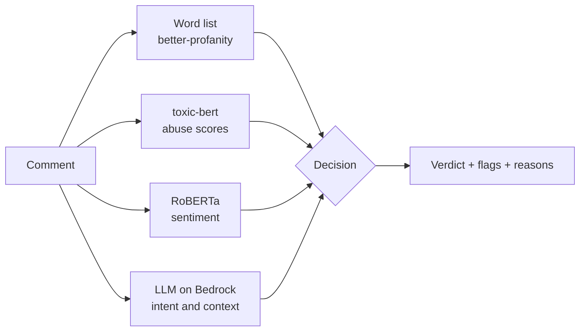

# Comment Guard

**Real-time moderation for user comments** - detects abusive language, separates harmless swearing from real
abuse, and recognises negative feedback (including sarcasm) before a comment is published.

Comment Guard combines three complementary layers - a fast word list, two transformer models running locally on
GPU or CPU, and a large language model on Amazon Bedrock - and merges their signals into one explainable verdict.

| Verdict | Meaning | Example |
|---|---|---|
| **Clean** | Fine to publish | "Great product, arrived early and works perfectly!" |
| **Negative feedback** | A complaint or unhappy tone, nobody attacked | "Oh wonderful, it broke again on day two. Just brilliant." |
| **Abusive** | Attacks a person or group - hidden from other users | "You are a useless idiot." |

Swearing on its own adds a **Profanity** tag and censors the word, without hiding an otherwise positive comment:
*"Holy shit, this is amazing!"* is **Clean · Profanity**.

## How it works



| Layer | Catches | Implementation |
|---|---|---|
| Word list | Swear words, including obfuscated forms like `sh1t` and `f***` | `better-profanity` + regex |
| Toxicity model | Insults, threats, identity hate | [`unitary/toxic-bert`](https://huggingface.co/unitary/toxic-bert) |
| Sentiment model | Complaints and dissatisfaction | [`cardiffnlp/twitter-roberta-base-sentiment-latest`](https://huggingface.co/cardiffnlp/twitter-roberta-base-sentiment-latest) |
| LLM (optional) | Sarcasm, context, intent, prompt-injection attempts | Any Bedrock text model through the boto3 Converse API |

### Design decisions

- **Swearing is not abuse.** toxic-bert's `toxic` and `obscene` labels fire on any profanity, even in praise.
  Abuse is decided only from the labels that mean someone is attacked - `insult`, `threat`, `identity_hate`,
  `severe_toxic` - while swearing becomes a separate, censorable flag.
- **The LLM decides when it is available.** It is the only layer that reads intent ("so bad it's good",
  sarcasm, praise that compares favourably against something worse). The toxicity model can still overrule it on a
  strong abuse score, so a single model mistake can't let a clear insult through.
- **Graceful degradation.** Without the LLM, rule-based logic over the BERT scores still produces a verdict -
  e.g. hostile wording with *no* swear word to explain it is treated as harassment or hate.
- **Model-agnostic LLM layer.** The Converse API keeps the request shape identical across Bedrock model families;
  the model is prompted for JSON, and every answer is validated before it is trusted.
- **Explainable output.** Every response says which layer decided and why, along with every layer's raw scores.

## Evaluation

Measured on two hand-labelled sets of borderline comments (swearing in praise, sarcasm, hate without slurs,
threats, prompt injection). The held-out set was written before any tuning and never used to tune.

| | Before tuning | After tuning |
|---|---|---|
| Final verdict - tuning set (23 comments) | 16 / 23 | **23 / 23** |
| Final verdict - held-out set (12 comments) | 8 / 12 | **11 / 12** |
| LLM layer alone - held-out set | 9 / 12 | **11 / 12** |
| Rules without the LLM - held-out set | - | 9 / 12 |

Reproduce with `python -m eval.run_eval` and `python -m eval.run_eval holdout.json` from `backend/`.
The sets are small; growing them with real traffic is the natural next step.

**Latency:** both transformer models together take ~100 ms per comment on 2 CPU threads (no GPU required); the
LLM call adds ~1-2 s.

## Tech stack

- **Backend:** Python, FastAPI, Hugging Face Transformers, PyTorch (CUDA when available), boto3
- **Frontend:** React 18, Vite
- **Cloud:** Amazon Bedrock (Converse API)
- **Testing:** pytest, botocore Stubber (LLM tests never call AWS)

## Getting started

Requirements: Python 3.11+, Node.js 18+.

```bash
# Backend
cd backend
python -m venv .venv
.venv/bin/pip install torch          # Windows: .venv\Scripts\pip install torch
.venv/bin/pip install -r requirements.txt

# Frontend
cd ../frontend
npm install
```

For an NVIDIA GPU, install the CUDA build of PyTorch instead:

```bash
pip install torch --index-url https://download.pytorch.org/whl/cu126
```

### Run

In two terminals:

```bash
cd backend && .venv/bin/python -m uvicorn app.main:app --port 8000
cd frontend && npm run dev
```

Open http://localhost:5173. The first start downloads both models (~1 GB).

Or serve the whole app - page and API - on a single port:

```bash
cd frontend && npm run build
cd ../backend && .venv/bin/python -m uvicorn app.main:app --host 0.0.0.0 --port 8000
```

On Windows, `start.ps1` and `share.ps1` do the same.

### Enable the LLM layer (optional)

Copy `backend/.env.example` to `backend/.env` and set:

- `BEDROCK_MODEL_ID` - any text model enabled in your Bedrock account
- `AWS_REGION`
- one credential option: access keys, `AWS_PROFILE`, or a Bedrock API key (`AWS_BEARER_TOKEN_BEDROCK`)

`.env` is git-ignored. Thresholds (`TOXICITY_THRESHOLD`, `ABUSE_OVERRIDE_THRESHOLD`, `NEGATIVE_THRESHOLD`) and
`FORCE_CPU` are configurable in the same file.

## API

| Method | Path | Description |
|---|---|---|
| `GET` | `/api/health` | Model status, CPU/GPU device, whether the LLM is configured |
| `POST` | `/api/analyze` | Body `{"text": "...", "use_llm": true}` - returns verdict, flags, reasons and per-layer scores |

Interactive docs at http://localhost:8000/docs.

```json
{
  "verdict": "clean",
  "flags": ["profanity"],
  "decided_by": "llm",
  "reasons": [
    "LLM: Positive feedback with a comparison to something worse, despite a swear word.",
    "Profanity censored: crap"
  ]
}
```

## Tests

```bash
cd backend && .venv/bin/python -m pytest -q
```

## Project structure

```
backend/
  app/
    main.py              FastAPI app, routes, static frontend
    analyzer.py          combines the layers into a verdict
    bert_models.py       toxicity + sentiment models (GPU/CPU)
    llm.py               Bedrock layer: prompt, call, JSON validation
    profanity_filter.py  word list + obfuscated-swearing detection
    config.py, schemas.py
  eval/                  labelled comment sets + evaluation script
  tests/                 API tests (real models) and stubbed LLM tests
frontend/
  src/App.jsx            comment feed, verdict badges, per-layer details
```
